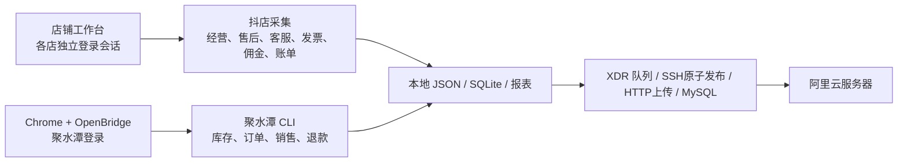

# 店铺工作台采集与阿里云同步工具箱

把原先散落在 Mac 用户目录下的取数脚本、店铺工作台源码、云端传输组件和定时任务整理到一个仓库，供新电脑部署、后续开发和按模块复用。

2026-10-25 源码快照，14 个组件。保留原来的项目边界和业务口径，增加统一目录清单、完整性校验和迁移入口。**它是源码工具箱；运行仍需店铺工作台、本人登录态和阿里云权限。**



| 能力 | 源码位置 | 运行入口 |
| --- | --- | --- |
| 店铺登录、Bridge、内置采集 | `components/shopdesk-workbench-src` | `src/main.js`、`src/agent-api.js`、`collectors/` |
| 经营指标、中差评、紫旗、旧版发票采集 | `components/doudian-daily` | `daily_collect.py`、`*_sync.py` |
| 售后待审核计数及 API 上传 | `components/projects/shopdesk-aftersale` | `bin/scrape_counts.py`、`bin/push.py` |
| 飞鸽逐客服表现及云端发布 | `components/projects/feige-customer-daily` | `collect.mjs`、`upload.mjs` |
| 发票采集与 PDF 回传代理 | `components/projects/invoice-mac-agent` | `capture-cli.mjs`、`agent.mjs` |
| 精选联盟佣金率 | `components/projects/douyin-commission-rates` | `uv run commission` |
| 月度账单下载、核对及 gzip 上传 | `components/projects/douyin-settle-recon` | `uv run recon` |
| 聚水潭库存预警 | `components/jushuitan-inventory-warning` | `jst-inventory` |
| 聚水潭报表订单明细 | `components/jushuitan-order-details` | `jst-orders` |
| 聚水潭业务订单页与详情 | `components/jushuitan-order-page` | `jst-order-page` |
| 聚水潭销售业绩 | `components/jushuitan-sales-performance` | `jst-sales` |
| 聚水潭售后、退款导出 | `components/jushuitan-aftersales` | `jst-aftersales`、`export-refund-daily.mjs` |
| 利润事实库构建与校验 | `components/jushuitan-profit-facts` | `bin/jst-profit-facts` |
| 任务队列、校验、上云、失败通知 | `components/projects/xdr-sync-agent` | `bin/xdr-sync-agent.js`；`server/` 为已有服务端源码 |

## 开始复用

```sh
python3 tools/toolkit.py inventory
python3 tools/toolkit.py verify
python3 tools/toolkit.py doctor
# 先预览；已有同名目录时停止，避免覆盖生产文件
python3 tools/toolkit.py prepare
# 仅在新机器或独立目标目录执行；复制源码并建立CLI链接
python3 tools/toolkit.py prepare --apply
```

安装依赖、登录、配置和单次取数见 [新机迁移与验收](docs/MIGRATION.md)。模块关系、上传方式及如何新增采集见 [能力复用说明](docs/REUSE.md)。验证范围见 [验证记录](docs/VALIDATION.md)。每个组件的 README 保留原作者的详细说明，其中历史数据和成功记录只代表原生产机当时状态。

## 仓库内容

- `components/`：独立源码副本，按原来 home / projects 路径排列。
- `runtime-wrappers/`：生产机已安装的 4 个工作台运行脚本快照。
- `schedules/`：26 个 launchd 任务定义，路径使用 `__HOME__` / `__NODE__`；环境变量未导出。
- `config/`：云端连接及 MySQL 环境变量示例。
- `tools/toolkit.py`：离线盘点、校验、迁移和调度文件生成。
- `docs/source-manifest.json`：每个来源文件的相对路径、SHA-256 和是否调整。

未纳入 Cookie、登录分区、密钥、真实凭据配置、业务数据库、报表、截图、安装包和备份。月度账单的 Excel 模板及历史样例文件需在本机另行提供；相关原有集成测试也依赖这些文件。OpenBridge 是外部依赖，未把其整个安装目录复制入仓库。

原脚本有部分路径和服务器地址固定为原部署值。迁移工具会替换用户名目录；阿里云目标、账号、权限及其他部署路径仍需按模块检查。当前整理未修改正在运行的生产项目，也未加载任务或执行真实采集/上云。
